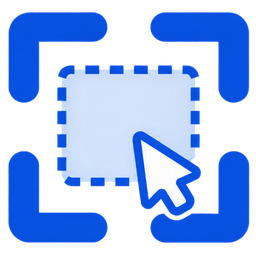

# EzCap

**화면 캡처, 이미지 편집, GIF 녹화를 한곳에서 사용하는 Windows x64 프로그램입니다.**

> EzCap 1.0.0은 Windows x64용입니다. 신규 사용자 화면 체크리스트 19개 항목에 대한 사용자 확인을 받았습니다. 모든 Windows 환경·업데이트·복구 검증을 완료한 것은 아니며, Windows Defender와 SmartScreen 검사는 미실시입니다.

## 다운로드

[공식 Releases](https://github.com/cubericka/EzCap/releases)에서 **EzCap 1.0.0**의 **`EzCap.1.0.exe`**를 받으세요. 파일명은 1.0, 프로그램 내부 버전은 1.0.0입니다.

일반 사용자는 설치 EXE 하나만 필요합니다. GitHub의 자동 생성된 `Source code (zip)`은 이 안내 저장소의 자료이며, 프로그램 소스나 설치 파일이 아닙니다. 프로그램 전체 소스는 공개하지 않습니다.

## 주요 기능

- 영역, 창, 단위 영역, 전체 화면 캡처
- 펜·선·화살표·도형·번호·모자이크·지우개를 이용한 이미지 편집, 실행 취소 및 다시 실행
- 이미지 저장·클립보드 복사, 최근 캡처 목록과 보관 편집
- 범위를 선택하는 GIF 녹화, 프레임 삭제·구간 선택·크기·재생 시간·반복 횟수 편집
- GIF 용량 예상과 저장 진행률·취소
- 트레이 메뉴, 단축키, 백그라운드 실행, 환경설정

아이콘은 실제 프로그램에서 사용하는 원본 리소스입니다. 공개 가능한 실제 EzCap 스크린샷은 아직 전달받지 않아 추가하지 않았습니다. 기능 화면을 재현한 가상 스크린샷은 사용하지 않습니다.

## 지원 환경과 설치

- Windows x64용 빌드입니다. 기존 개발·사용 확인 환경은 Windows 11 x64입니다. 이번 이름 변경본의 신규 설치·화면 표시·캡처·편집·GIF·설정·트레이·제거는 사용자 확인을 받았습니다. 확인 PC의 상세 Windows 빌드는 제공되지 않았으며, 기존 설치본 업데이트와 특수 오류 상황은 별도 미검증입니다.
- 필요한 .NET 런타임은 설치 EXE에 포함됩니다. 별도 ZIP 해제나 .NET 다운로드가 필요하지 않습니다.
- 현재 사용자용 설치입니다. 관리자 권한을 자동 요청하지 않으며 쓰기 가능한 설치 폴더를 선택해야 합니다.

1. 공식 Releases에서 `EzCap.1.0.exe`와 `SHA256SUMS.txt`를 다운로드합니다.
2. 필요한 경우 [해시 확인](docs/INSTALL-UPDATE.md#sha-256-확인)으로 파일 동일성을 확인합니다.
3. GitHub가 공백을 점으로 바꾸므로 다운로드한 `EzCap.1.0.exe`의 이름을 **`EzCap 1.0.exe`**로 바꾼 뒤 실행하고 설치 경로를 확인합니다. 권한이 부족하면 **내 사용자 폴더**를 선택합니다.
4. 바로가기 생성 여부를 선택하고 **설치 / 업데이트**를 누릅니다. 완료 후 **마침**으로 실행합니다.

## 기본 사용 방법

캡처 실행창에서 캡처 방식을 선택합니다. 영역 선택을 취소하려면 Esc를 누릅니다. 결과 편집창에서 그림·도형 등을 추가하고 저장하거나 복사합니다. 기존 이미지 파일도 열 수 있습니다.

GIF 녹화 메뉴에서 범위를 고르고 **녹화 시작**을 누릅니다. 녹화 종료 후 편집창에서 프레임, 크기, 재생 시간을 조절하고 **GIF 저장**을 누릅니다. **프레임을 삭제하면 그 시간도 함께 삭제**되며 다른 프레임에 시간이 합쳐지지 않습니다. 실행 취소로 편집을 되돌릴 수 있습니다.

기본 단축키는 Ctrl+Shift+C(영역), Ctrl+Shift+W(창), Ctrl+Shift+D(단위 영역), Ctrl+Shift+A(전체 화면), Ctrl+Shift+G(GIF)이며 녹화 중지는 F10입니다. Print Screen의 기본 동작은 영역 캡처입니다. 다른 앱과 충돌하면 환경설정에서 변경하세요.

결과창을 닫으면 실행창으로 돌아갑니다. 기본 설정에서 실행창 X는 트레이로 숨깁니다. 완전히 종료하려면 트레이의 **프로그램 종료**를 사용하세요.

## 설정

환경설정에서 일반 동작, 이미지 저장 형식·경로, 단축키, 캡처 목록, GIF 녹화 목표 FPS, 캡처 색상을 설정합니다.

기본적으로 자동 클립보드 복사와 트레이 숨기기가 켜져 있고, **정상 종료 시 최근 캡처 목록과 해당 캐시를 정리**합니다. 필요한 결과는 파일로 저장하거나 보관 편집에서 확인하세요. 저장해 둔 개인 이미지·GIF와 보관 편집을 최근 목록과 혼동하지 마세요. 최근 목록 유지가 필요하면 환경설정의 종료 시 목록 정리 옵션을 바꾸세요.

GIF 녹화 목표는 1~200 FPS, 새 설정의 기본값은 12 FPS입니다. 목표 FPS는 보장 속도가 아닙니다. 녹화 크기·PC 성능·디스크 상태에 따라 실제 FPS가 달라집니다. 편집창의 **재생 FPS 적용**은 녹화 성능이 아니라 재생 시간을 바꿉니다.

## 업데이트·제거·사용자 데이터

자동 온라인 업데이트 기능은 없습니다. 새 설치 EXE를 내려받아 실행하면 기존 설치 경로를 인식합니다. 같은 버전도 재설치할 수 있도록 구성되어 있습니다. 설치 전 중요한 자료를 별도로 백업하세요.

Windows 설치된 앱 목록에서 **EzCap**을 제거합니다. **프로그램 설정 및 캐시 파일도 삭제**를 선택하지 않으면 설정과 내부 캐시를 보존합니다. 선택해도 개인 캡처 원본·보관 편집·저장한 이미지·GIF는 삭제 대상으로 삼지 않습니다. 소유권을 확인할 수 없는 파일은 보존합니다.

이름 변경 전 데이터를 연결하기 위해 기존 데이터 폴더·설치 식별자·일부 내부 실행 파일명은 유지합니다. 폴더에 이전 이름이 남아 있어도 임의로 이름을 바꾸거나 삭제하지 마세요. [데이터 및 설치 안내](docs/INSTALL-UPDATE.md)를 참고하세요.

## 알려진 제한사항

- GIF는 프레임당 최대 256색이고 시간 단위는 10ms입니다. 디더링을 사용하지 않아 사진·그라데이션에서 색상 차이나 띠가 보일 수 있습니다.
- GIF 저장은 재생 호환성을 위해 프레임당 최소 20ms, 최대 50 FPS로 변환합니다. 고속 녹화의 일부 프레임을 생략하고 동일 프레임을 병합할 수 있어 녹화 원본 수와 출력 수가 다릅니다. 전체 시간은 GIF 시간 단위에 맞게 반올림되며 극히 짧은 애니메이션은 최소 지연으로 늘어날 수 있습니다.
- 녹화 임시 데이터는 2GB 또는 18,000프레임 한도에서 중지합니다. 긴 녹화는 임시 디스크 공간을 사용합니다.
- 창 녹화는 선택 당시 위치·크기를 사용하며 움직이는 창을 자동 추적하지 않습니다.
- 보호된 화면·특수 렌더링 화면은 캡처가 제한될 수 있습니다. HDR 색상 결과는 모니터·그래픽 드라이버에 따라 다릅니다.
- 단축키 충돌과 시스템 자원 부족, 접근 권한·파일 잠금 때문에 작업이 실패할 수 있습니다. 모든 상황의 데이터 복구나 일정한 FPS를 보장하지 않습니다.

## 코드 서명 및 Windows 보안 안내

이 배포 파일은 **코드 서명되지 않은 EXE**입니다. Windows SmartScreen이 알려지지 않은 앱 경고를 표시하거나 조직 정책이 실행을 차단할 수 있습니다. 공식 배포처와 해시를 확인하고, 보안 경고가 있으면 내용을 검토하세요. 보안 기능 비활성화나 우회는 안내하지 않습니다.

이번 빌드의 **Windows Defender 검사와 SmartScreen 검증은 미실시**입니다. 일반 설치 화면에서 보안 경고 여부를 확인한 항목을 Defender·SmartScreen 검사 통과로 해석하지 않습니다. 해시 일치는 파일 동일성 검사이며 악성코드 검사를 대신하지 않습니다. 향후 정식 서명을 적용해도 경고가 반드시 사라지는 것은 아닙니다. [Microsoft 안내](https://learn.microsoft.com/en-us/windows/security/operating-system-security/virus-and-threat-protection/microsoft-defender-smartscreen/)

## 문제 해결 및 오류 보고

설치 경로 권한이 부족하면 쓰기 가능한 전용 폴더를 선택하세요. 파일 잠금 오류는 관련 프로그램을 정상 종료한 후 재시도하세요. 설치 목록·데이터 폴더·임시 작업 폴더를 임의로 삭제하지 마세요.

[Issues](https://github.com/cubericka/EzCap/issues)에 프로그램 버전, Windows 버전, 재현 순서, 실제 오류 내용, 재현 빈도를 적어 주세요. GIF 문제는 녹화 목표·실제 FPS, 편집 원본 수, 출력 프레임 수, 전체 시간을 함께 적으면 도움이 됩니다. 오류창의 진단 로그 위치를 확인하되, 공개 전 사용자명·개인 경로·캡처 화면·비밀값을 지우세요.

## 개발자·저작권·출처

- 프로그램: **EzCap 1.0.0**
- 개발자: **모르윈**
- Copyright © 2026 아카라이브 모르윈
- 원본 배포처: https://github.com/cubericka/EzCap

재배포 시 원본 프로그램 이름, 개발자, 원본 배포처와 저작권을 표시하세요. [출처 표기 및 이용 조건](TERMS.md)과 [필수 라이선스 고지](THIRD-PARTY-NOTICES.md)를 함께 확인하세요. 이 저장소에 프로그램 소스코드의 공개 라이선스를 새로 부여하지 않습니다.
